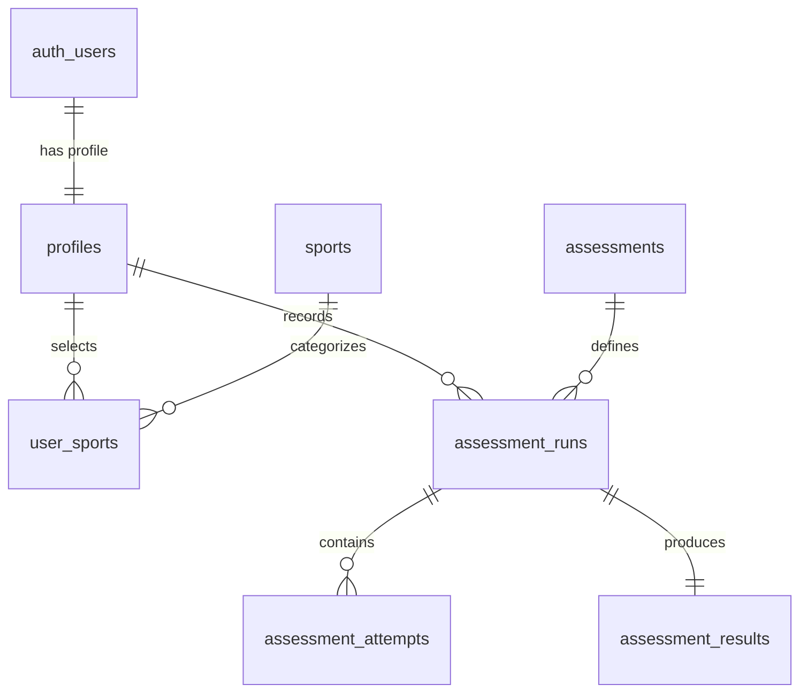

# SportSense AI — Database Architecture & Migrations

This directory contains PostgreSQL schema definitions, Row Level Security (RLS) policies, and seed data for Supabase.

---

## 📁 File Structure

```
database/
├── schema.sql         # Core DDL tables, foreign keys, constraints, and indexes
├── rls_policies.sql   # Row Level Security isolation rules and storage bucket permissions
├── seed.sql           # Initial catalog of sports and assessment definitions
└── README.md          # Setup and migration guide
```

---

## 🗄️ Relational Entity Model



---

## 🚀 Migration Instructions

1. Open your **Supabase Dashboard** -> **SQL Editor**.
2. Run `database/schema.sql` to generate all tables and constraints.
3. Run `database/rls_policies.sql` to apply Row Level Security and create the `assessment-videos` storage bucket.
4. Run `database/seed.sql` to populate default sports and assessment catalogs.
